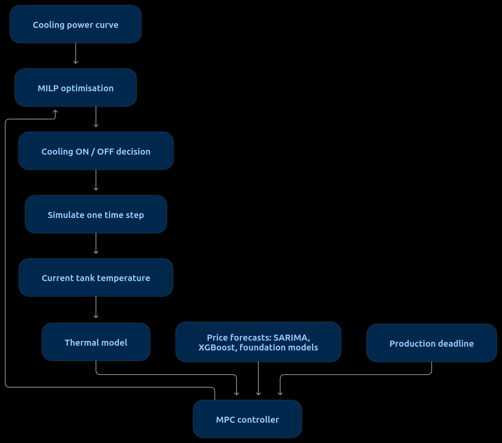

A **forecast-informed, rolling-horizon optimisation of brewery fermentation-tank cooling**, using the Veltins case study in von Hayn (2025) as the reference [1].

The goal is to reproduce the thesis's baseline methodology first, then introduce multi-day electricity-price forecasting as your main innovation. This can be subsequently extended to the model with two or more cooling tanks.

## Overview

### **1. Proposed project formulation**

**Working title**

*Cost-Optimal Scheduling of Brewery Fermentation Cooling using Multi-Day Electricity Price Forecasting*

**Main objective**

Develop and evaluate a forecasting-based optimisation framework that schedules fermentation-tank cooling to minimise electricity costs while respecting beer-temperature requirements and production deadlines.

**Fermentation-tank cooling**

Fermentation-tank cooling is a critical part of beer maturation (lagering), where beer is cooled after primary fermentation to promote yeast sedimentation, improve colloidal stability and refine flavour. Residual yeast converts diacetyl, formed via the α-acetolactate pathway, into less flavour-active compounds such as acetoin and 2,3-butanediol. Cooling also supports the precipitation of haze-forming protein–polyphenol complexes and natural carbonation during conditioning [2].

At Veltins, the thesis examines the main cooling phase (a phase in/after the beer maturation process) from **14.5°C to 2°C**, averaging **107 hours**. GT01 (a single fermentation tank) consumed **38,805 kWh** across its 2022 cooling cycles. Optimisation reduced energy use by only **1.1%**, but electricity costs by **12.7–14.5%** [1].

Literature estimates that fermentation and maturation account for **60–70% of a brewery's refrigeration capacity** [Needs citation]. (**Important:** This 60–70% figure refers to refrigeration capacity, not total brewery energy consumption.)

### **2. Methodology**

**Project design specs**

| Component             | Decision                                                                   |
| --------------------- | -------------------------------------------------------------------------- |
| Simulation period     | 01 Oct 2025 – 30 Sep 2026                                                  |
| Production schedule   | Reuse GT01's 2022 fermentation-cycle timings                               |
| Electricity price (+ scenarios) forecasting     | SARIMA, XGBoost, foundation models                                         |
| Baseline controller   | Rule-based MPC, following the thesis                                       |
| Proposed contribution | MILP-based MPC (could be stochastic optimisation)                                                            |
| Evaluation            | Compare costs, energy use, temperature constraints and deadline compliance |

**Project stages**

| Stage                   | Methodology                                                             | Purpose                                                                 |
| ----------------------- | ----------------------------------------------------------------------- | ----------------------------------------------------------------------- |
| 1. Process modelling    | Reconstruct the fermentation cooling model using thesis parameters.     | Represent tank temperature and cooling demand.                          |
| 2. Baseline simulation  | Simulate conventional continuous cooling from 14.5°C to 2°C.            | Establish reference energy consumption and costs.                       |
| 3. Price forecasting    | Develop electricity-price forecasting models for horizons of 2–7 days.  | Predict future electricity prices.                                      |
| 4. Optimisation         | Use forecasts to schedule cooling interruptions and operation.          | Minimise cooling costs subject to temperature and deadline constraints. |
| 5. Evaluation           | Compare conventional, day-ahead and multi-day forecast-based operation. | Quantify the benefits of longer forecasting horizons.                   |
| 6. Multi-tank extension | Extend the model to two tanks with coordinated cooling schedules.       | Investigate shared refrigeration capacity and scheduling conflicts.     |

> **Read the [mathematical formulation](docs/mathematical_formulation.md) for more details on the thermal process model and optimisation problem.**

### **3. Proposed experimental design**

For the single-tank model:

1. **Conventional operation:** Continuous cooling without considering electricity prices.
2. **Day-ahead optimisation:** Use next-day electricity prices, following the thesis methodology.
3. **Multi-day optimisation:** Use forecasts for 2, 3, 4, 5 and 7 days.

4. **Perfect-foresight benchmark:** Use actual future prices to estimate the theoretical benefit of perfect price information.

Cost savings, cooling energy consumption, deadline compliance, temperature constraints and forecast errors will be evaluated. For the two-tank extension, shared cooling capacity may be introduced and its impact on coordinated scheduling and overall cost savings can be investigated.

### 4. Tech stack

- **Programming language:** Python
- **Optimisation solver:** Pyomo (SCIP)
- **Forecasting models:** SARIMA, XGBoost, foundation models
- **Database:** PostgreSQL
- **Data Transformation:** dbt
- **Data handling:** Pandas, NumPy, scikit-learn
- **Simulation and modelling:** Custom Python scripts based on thesis parameters [1]
- Other python packages as required.

# References

1. Adrian von Hayn, 2025. Dissertation: .
2. Elizabeth J. Lodolo, Johan L.F. Kock, Barry C. Axcell, Martin Brooks, The yeast Saccharomyces cerevisiae– the main character in beer brewing, FEMS Yeast Research, Volume 8, Issue 7, November 2008, Pages 1018–1036, https://doi.org/10.1111/j.1567-1364.2008.00433.x