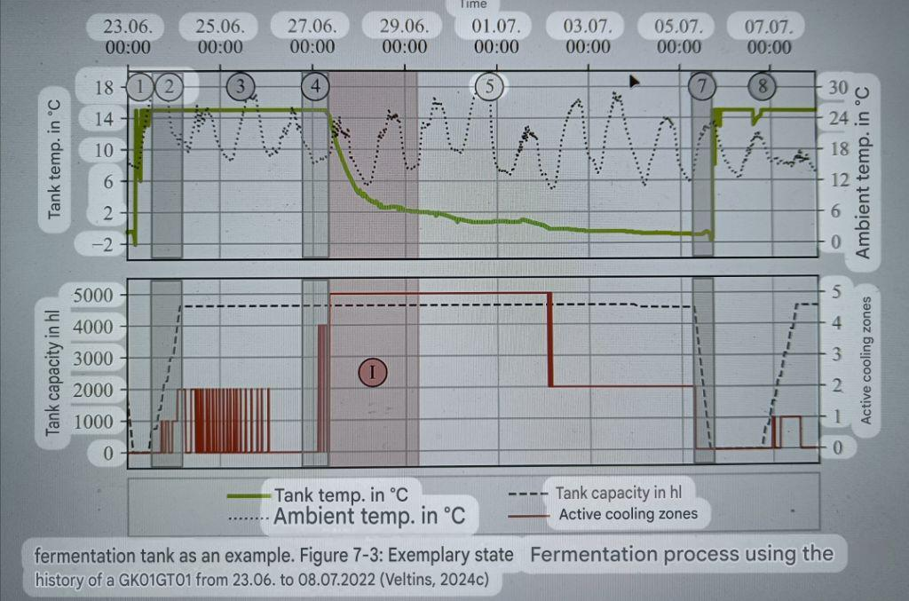
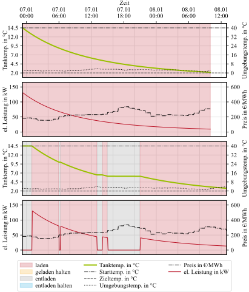
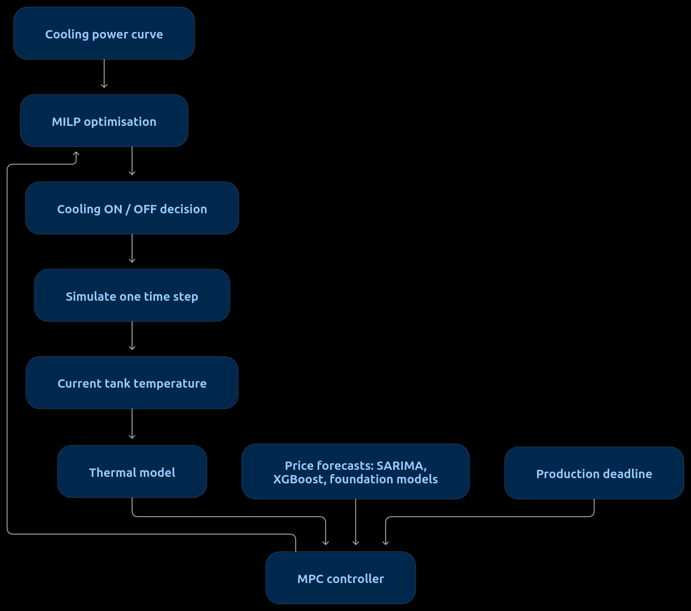

# Energy optimisation of brewery fermentation-tank cooling

The project is building a **forecast-informed, rolling-horizon optimisation of brewery fermentation-tank cooling**, using the Veltins case study in von Hayn (2025) as the reference [1]. This includes a model-predictive control (MPC) framework that integrates forecasted electricity prices with the thermal dynamics of the fermentation tank (the *Gärtank*) to optimize cooling schedules.

In plain terms: the controller repeatedly decides when the tank's cooling system should run, so that the beer reaches its target temperature on time while using electricity in cheaper hours. Each decision is made with a mixed-integer linear programme (MILP) that predicts the tank temperature under several possible future price paths.

## Overview
**Beer**, the favorite beverage of many, is produced through a complex, multi-step process that involves mash preparation, fermentation, conditioning, and other stages before it reaches the consumer. Through these various stages, the raw material 
goes through varying temperature conditions that must be carefully controlled to ensure proper fermentation and product quality.

Fermentation-tank temperature control is a critical part of beer fermentation and maturation (lagering) processes to promote yeast growth, sedimentation, improve colloidal stability and refine flavour. **Intermediate stages include energy-intensive cooling and temperature maintenance, which offer opportunities for energy optimisation.** Cooling is energy-intensive because the tank, its contents and its surroundings all add heat that the refrigeration plant must remove, and the plant's capacity depends on the temperature it is working against.

This figure with translated text shows the temperature profile of the Veltins fermentation tank as reported in von Hayn (2025) [1].

### The Main Cooling Phase
This project focuses on the main cooling phase, which is identified in the thesis by von Hayn (2025) [1] as the period after beer maturation where the temperature is actively reduced from **14.5°C to 2°C**. GT01 (a single fermentation tank) consumed **38,805 kWh** across its 27 cooling cycles in the year 2022, ranging from 35-55 hours per cycle. The cooling has a deadline: the tank must reach the target within the cycle. This leaves room to shift cooling work into cheaper price periods, as long as the deadline is still met.

<!-- Optimisation reduced energy use by only **1.1%**, but electricity costs by **12.7–14.5%** [1]. -->

> Germany offers dynamic electricity pricing and allows for demand-side flexibility in energy consumption. Knowledge of **future electricity prices** along with **model-predictive control** (MPC) strategies can enable breweries to optimize their cooling schedules and reduce electricity costs.

This simulated plot from von Hayn (2025) [1] shows the temperature trajectory a cooling cycle of the fermentation tank follows, both with and without optimisation. The optimized trajectory (bottom plot) avoiding peak price period is an output of rule-based model-predictive control (RBMPC) strategy applied to the cooling process.

## A Forecast-Based Stochastic MILP-MPC Framework

> This project investigates whether leveraging multi-day electricity price forecasts, beyond the available D+1 day-ahead prices, can improve the cost-effectiveness of fermentation-tank cooling in breweries.

To this end, the project is developing a stochastic MPC framework that incorporates multi-day electricity price forecasts into the optimization of brewery fermentation-tank cooling schedules. The diagram below illustrates the conceptual structure of this framework.

### Planned approach

- **Known and uncertain prices.** Day-ahead prices already published at the forecast time are treated as known. Prices for D+2 and D+3 are uncertain and are represented by a small set of weighted price scenarios, each with a probability. Future realised prices are never used as inputs to the forecast.
- **Two-stage decisions.** The cooling actions for the first configurable period (planned as 24 hours) are shared by all scenarios, because they must be committed before the later prices are known. Later actions may differ by scenario. The MILP minimises the expected electricity cost across scenarios, so it accounts for how the first-stage decisions affect later, scenario-specific cooling.
- **Two kinds of temperature requirement.** If the prediction horizon ends before the deadline, the controller sets an *intermediate milestone*: a temperature upper bound that follows a fourth-power cooling curve, with a configurable tolerance. If the deadline falls within the horizon, the MILP must reach the target by the deadline with no tolerance above the target. Neither requirement is a soft penalty. Meeting a milestone does not guarantee that the deadline can still be met.
- **Rolling horizon.** Only the first shared action is applied to the plant. The controller then re-observes the tank, updates the forecasts, and re-solves at the next decision point.
- **Physics model.** Tank temperature follows the cooling-capacity curve and a linear heat exchange with the ambient temperature, $UA(T_{\mathrm{ambient}}-T)$, following von Hayn (2025) [1]. This is a prediction model, not a verified description of the FMU's internals.
- **Forecasting.** XGBoost price forecasting is planned, with chronological training and validation and models updated through offline monthly snapshots during the 2025 evaluation. The scenario-generation method is still an open design decision.

### Current status

- Implemented: the standalone two-stage stochastic cooling MILP, input validation, and tests. See [docs/STOCHASTIC_COOLING_MILP.md](docs/STOCHASTIC_COOLING_MILP.md).
- Planned: configurable optimality-gap acceptance, a heuristic warm-start trajectory, the stochastic MPC controller, the forecast-provider contract, and the FMU integration runner.

## Installation details

On Linux x86-64, `uv` installs the CPU build of PyTorch. The project pins `marshmallow` and `polars` to versions compatible with the weather dependencies used by the current `eta_utility` installation.

The bundled FMU includes a Linux binary as well as a Windows binary.

# References

1. Adrian von Hayn, 2025. Dissertation: .
2. Elizabeth J. Lodolo, Johan L.F. Kock, Barry C. Axcell, Martin Brooks, The yeast Saccharomyces cerevisiae– the main character in beer brewing, FEMS Yeast Research, Volume 8, Issue 7, November 2008, Pages 1018–1036, https://doi.org/10.1111/j.1567-1364.2008.00433.x